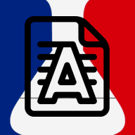

# Batch-Filigrane



**Filigranage par lot de documents PDF et images — 100 % hors-ligne, en parallèle, avec téléchargement séparé ou fusionné.**

---

## Pourquoi ce projet ?

Le service public [FiligraneFacile](https://filigrane.beta.gouv.fr/) développé par l'équipe *DossierFacile* est très pratique pour protéger ses documents administratifs, mais présente deux limites pour un usage intensif ou sensible :

1. **Fusion forcée lors de l'envoi multiple** : sur le site officiel, lorsque l'on sélectionne plusieurs fichiers en même temps, ils sont automatiquement fusionnés en un seul document PDF unique. Il est impossible de traiter un dossier entier d'un seul coup tout en récupérant un fichier PDF distinct par document d'origine.
2. **Envoi des documents sur un serveur distant** : le traitement nécessite de téléverser ses pièces justificatives (pièces d'identité, avis d'imposition, bulletins de salaire, RIB…) sur un serveur externe.

**Batch-Filigrane** répond à ces deux besoins en réimplémentant l'algorithme open-source de *DossierFacile* (`BOPdfDocumentTemplate` & `DFFilter`) pour permettre :
- **Un fonctionnement 100 % local et hors-ligne** : aucun document ne quitte votre ordinateur.
- **Un traitement par lot en parallèle** : déposez des dizaines de PDF ou d'images simultanément.
- **Le choix du mode de récupération** :
  - **Séparément** : récupérez chaque document sous forme de PDF individuel (`.PDF par .PDF` ou regroupés dans une archive `.ZIP`).
  - **En jointure** : récupérez l'ensemble des documents assemblés en un seul PDF fusionné.

---

## 1. Version Web JavaScript (100 % Navigateur & Hors-Ligne)

L'application fonctionne directement dans le navigateur grâce au moteur client-side ([`browser_engine.js`](./src/batch_filigrane/static/browser_engine.js)), sans nécessiter de serveur back-end ni de connexion internet. Toutes les dépendances (`PDF.js`, `jsPDF`, `JSZip`, `jsQR`) sont embarquées localement dans [`src/batch_filigrane/static/vendor/`](./src/batch_filigrane/static/vendor/).

### Utiliser via GitHub Pages
- Accédez directement à la version hébergée sur GitHub Pages : **[https://corentinrhr.github.io/Batch-FiligraneFacile/](https://corentinrhr.github.io/Batch-FiligraneFacile/)**
- Une fois la page chargée, vous pouvez même couper votre connexion internet : tout le rendu, la rastérisation A4, l'application du filigrane et la génération des PDF s'exécutent localement dans votre navigateur.

### Lancer la version JS en local (sans Python)
Vous pouvez servir le dossier statique [`src/batch_filigrane/static`](./src/batch_filigrane/static) avec n'importe quel serveur de fichiers statiques :

```powershell
npx serve src/batch_filigrane/static
```

### Déployer sur votre propre GitHub Pages
Le workflow [`.github/workflows/deploy-pages.yml`](./.github/workflows/deploy-pages.yml) publie automatiquement le dossier [`src/batch_filigrane/static`](./src/batch_filigrane/static) sur GitHub Pages à chaque `push` :
1. Dans votre dépôt GitHub, ouvrez **Settings ➔ Pages**.
2. Sous **Build and deployment ➔ Source**, sélectionnez **GitHub Actions**.

---

## 2. Version Python Locale (Serveur FastAPI Multi-Threadé avec `uv`)

Pour traiter de très gros volumes de documents avec les performances natives de Python (`PyMuPDF`, `Pillow`, `NumPy` et `OpenCV`), le projet inclut également un serveur local FastAPI géré avec [`uv`](https://docs.astral.sh/uv/). Lorsque le serveur Python tourne, l'interface web l'utilise automatiquement.

### Installation et démarrage rapide

```powershell
# 1. Installer l'environnement et les dépendances via uv
uv sync

# 2. Lancer le serveur local (ouvre automatiquement http://127.0.0.1:8000)
uv run batch-filigrane
```

Options en ligne de commande :

```powershell
uv run batch-filigrane --port 8080 --no-browser
```

### Lancer les tests automatisés

```powershell
uv run pytest -v
```

---

## Algorithme & Fidélité au Code Source Amont (`MTES-MCT`)

Les deux moteurs — JavaScript ([`browser_engine.js`](./src/batch_filigrane/static/browser_engine.js)) et Python ([`watermark_engine.py`](./src/batch_filigrane/watermark_engine.py)) — réimplémentent fidèlement les étapes du module `dossierfacile-pdf-generator` :

- **Rastérisation sécurisée A4** (`128`, `150`, `220` ou `300 DPI`) : le filigrane est fusionné dans les pixels de l'image de chaque page afin d'empêcher sa suppression en un clic dans un éditeur PDF.
- **Double calque incliné à `-25°`** : texte répété sur 10 lignes avec opacité aléatoire (`0.52–0.60`) + calque d'ombre à flou gaussien (`sigma = radius / 3`).
- **Préservation des QR Codes / 2D-Doc** *(activé par défaut)* : détection automatique des QR codes et détourage d'une marge de `20px` pour garantir leur lisibilité.
- **Alternance des couleurs** *(activé par défaut)* : alterne gris anthracite, bleu foncé et rouge sur les lignes du filigrane.
- **Ondulation anti-OCR (`DFFilter`)** *(activé par défaut)* : distorsion sinusoïdale empêchant le nettoyage automatisé par IA/OCR.

### Suivi des mises à jour du dépôt officiel DossierFacile
Une table de correspondance détaillée est disponible dans **[`UPSTREAM_SOURCES.md`](./UPSTREAM_SOURCES.md)**. Pour vérifier si l'équipe `MTES-MCT` a modifié les fichiers sources d'origine sur GitHub et afficher le `diff` exact :

```powershell
uv run python -m batch_filigrane.check_upstream
```

---

## Licence & Non-affiliation

Le code source de ce projet ainsi que la **version Web 100 % JavaScript / Navigateur** (et ses dépendances embarquées : `PDF.js` Apache-2.0, `jsPDF` MIT, `JSZip` MIT, `jsQR` Apache-2.0) sont distribués sous **[Licence MIT](./LICENSE)**.
- **Note sur les dépendances du moteur Python local** : Le serveur Python optionnel utilise la bibliothèque `PyMuPDF` (`fitz`), qui est distribuée sous licence **AGPL-3.0** (ou licence commerciale Artifex). Si vous redistribuez une version empaquetée incluant le moteur Python avec `PyMuPDF`, les conditions de l'AGPL-3.0 s'appliquent à cette distribution Python. La version Web 100 % navigateur (GitHub Pages) n'est pas concernée et reste intégralement sous licences permissives (MIT / Apache-2.0).
- **Non-affiliation** : Ce projet n'est affilié ni à **DossierFacile**, ni à **FiligraneFacile**, ni à l'État français.
- **Design indépendant** : Conformément aux règles d'utilisation des dépôts de l'État, cette application **n'utilise pas** le Système de Design de l'État Français (DSFR), ni la police *Marianne*, ni les logos ou marques déposées de l'État. Seul l'algorithme open-source de traitement d'image et de PDF (publié sous licence MIT par [`MTES-MCT/dossierfacile-backend`](https://github.com/MTES-MCT/dossierfacile-backend) et [`MTES-MCT/Dossier-Facile-Frontend`](https://github.com/MTES-MCT/Dossier-Facile-Frontend)) a été réimplémenté.
